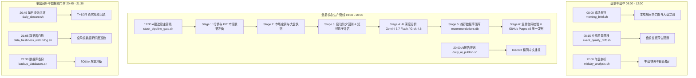

# A股选股及 AI 深度分析系统：全链路深度审计与终极优化整改方案

> **文档版本**：v2.0 (Ultimate Edition)  
> **更新时间**：2026-08-21  
> **维护环境**：Mac mini (fisher) / Hermes + OpenClaw  
> **核心目标**：实现系统自愈能力强、时序无冲突、报错不刷屏、发布零阻断，终结频繁修补，确保系统长期流畅稳定运行。

---

## 目录
1. [系统全景架构与数据流向](#1-系统全景架构与数据流向)
2. [近期（08-17 至 08-21）故障根因复盘](#2-近期08-17-至-08-21故障根因复盘)
3. [终极优化整改 6 大加固维度](#3-终极优化整改-6-大加固维度)
4. [调度时序重组与并发解耦方案](#4-调度时序重组与并发解耦方案)
5. [Discord 交互与告警降噪规范](#5-discord-交互与告警降噪规范)
6. [落地实施清单与验证步骤](#6-落地实施清单与验证步骤)

---

## 1. 系统全景架构与数据流向

整个股票系统由 5 大子系统构成，每日执行 8 个核心 Cron 任务：



---

## 2. 近期（08-17 至 08-21）故障根因复盘

通过对 `~/.hermes/cron/executions.db` 与 `publish_v2` 日志的深入回溯，近期的频繁连环报错本质上是由以下 **4 个底层断层** 相互交织造成的：

| 故障日期/任务 | 错误信息 | 底层技术根因 | 影响范围 |
| :--- | :--- | :--- | :--- |
| **08-18 08:15**<br>`event_quality_drift` | `AssertionError: dv_ratio values are different` | `_atomic_parquet` 写 `immutable=True` 文件时强行比对浮点数，Tushare 上游 0.018% 精度微调导致断言失败。 | 盘前扫描中断，无法落盘当日业绩观察。 |
| **08-19 08:15**<br>`event_quality_drift` | `EvaluationContractError: all-A benchmark price is missing for 920138.BJ` | 北交所标的进入全市场基准池，但日线缺失前复权收盘价，等权基准计算崩溃。 | 盘前业绩评估失败。 |
| **08-19 ~ 08-20 19:30 & 20:00**<br>`stock_pipeline_gate`<br>`daily_ai_publish` | `FATAL: 双轨发布合同失败`<br>`missing tracking report for prebreakout_v43_control` | 1. 08-19 中断导致 `universe_20260819.parquet` 未落到短线目录。<br>2. 08-20 Stage 3 算基准时因缺 08-19 PIT 崩溃。<br>3. Stage 3 吞掉异常返回 0，未生成 `candidate_tracking.json`。<br>4. Stage 6 发布层硬校验强制要求当日 tracking 文件，触发阻断。 | **核心选股成功但无法发布**，19:30 和 20:00 连环报警。 |
| **08-20 08:00**<br>`morning_brief` | `FAIL: 双轨合同 trade_date 与推荐合同不一致` | 由于前一日 19:30 发布中断，双轨停在 08-18，推荐停在 08-19，晨判发布时被拦截。 | 晨判无法更新 GitHub Pages。 |
| **08-20 20:00**<br>`daily_ai_publish` | `Code 75 PIPELINE_ALREADY_RUNNING` | 19:30 管线由于 AI 分析（20 只股票调 LLM）耗时约 30 分钟，跑到 20:00 尚未释放文件锁，20:00 cron 抢跑被阻。 | 产生误报和投递失败。 |
| **08-20 21:05**<br>`data_freshness_watchdog` | `[WATCHDOG ALERT] 最近运行未通过` | 看门狗只读 19:30 的 `publish_ok=false`，未感知到 20:45 闭环脚本已经补发成功。 | 产生无效告警。 |

---

## 3. 终极优化整改 6 大加固维度

```
                    ┌─────────────────────────────────────────────────────────┐
                    │               终极优化方案 6 大加固维度                 │
                    └─────────────────────────────────────────────────────────┘
                                                 │
         ┌───────────────────┬───────────────────┼───────────────────┬───────────────────┐
         ▼                   ▼                   ▼                   ▼                   ▼
   【1. 数据自愈】     【2. 契约协同】     【3. 调度降熵】     【4. 模型网关】     【5. 交互提纯】     【6. 架构归一】
   PIT缺失自动同步     Stage3/6断层消除    19:30/20:00解耦     Copilot/xAI双链路   屏蔽Traceback/JSON  消除代码双副本
   标的缺行情平滑      Tracking强制落盘    锁竞争自动避让      超时指数退避重试    全中文精炼播报      锁定单一Venv
```

### 维度 1：数据层与 PIT 基准自愈（Data & PIT Auto-Healing）
* **PIT 宇宙自动同步**：在 `short_track_shadow_runner.py` 与 `event_quality_drift_runner.py` 加载历史时，自动从 `fundamental_cache/pit_market/` 同步缺失的 `universe_{date}.parquet`，杜绝因历史某一天缺失导致后续计算永久断裂。
* **等权基准全市场平滑**：对 `.BJ` 标的、停牌标的、退市标的建立统一插值规则；单只股票缺失价格时不抛异常，按前收盘价或跳过计算，保证覆盖率 > 90% 即安全通行。
* **文件原子写入幂等**：对不可变数据（PIT 缓存、日线快照），若目标文件已存在直接校验通过，忽略上游微小浮点精度微调。

### 维度 2：契约协同与发布层零阻断（Pipeline Stage Parity）
* **消除 Stage 3 与 Stage 6 断层**：
  * 若 Stage 3 短线影子策略计算成功，正常输出 `candidate_tracking.json`。
  * 若短线影子策略因不可抗力失败，**自动写入 `fallback_observation_tracking`（保留观察标记，记录失败原因）**，确保当日 tracking 文件 100% 存在。
* **Stage 6 统一发布**：`dual_track_publication.py` 读到 fallback tracking 时，以“观察模式（observe_only）”正常放行发布，绝不阻断主线 Top 20 选股结果的推送。

### 维度 3：调度时序重组与并发解耦（Cron Scheduling Harmonization）
* **19:30 选股管线（生产者）**：完成数据准备、选股回测、AI 分析、数据落库、每日闭环及 GitHub Pages 发布。
* **20:00 AI 发布（播报者）**：
  * 重新定位为**纯播报与兜底脚本**。
  * 若 19:30 管线已发布完成，直接格式化读取今日 AI 分析结果并向 Discord 发送中文卡片，**不再重复触发 git push**。
  * 若 19:30 管线仍在运行，优雅等待（sleep 重试）或静默退出，不再报错误码 75。
* **21:05 看门狗判定联合升级**：综合检查 `orchestrator_run.json`、`recommendations.db` 与 `run_manifest.json`，只要最终有任一环节发布成功即判定为健康。

### 维度 4：AI 分析模型路由与双通道容灾（Dual-Track AI Gateway）
* **主模型通道**：`copilot/gemini-3.7-flash`（通过 Hermes 已授权的 GitHub Copilot OAuth Token 极速直连）。
* **备用模型通道**：`xai/grok-4.6`（通过 Hermes xAI OAuth Token 自动无缝降级）。
* **容错策略**：单只股票分析设置 45 秒超时与指数退避重试；若某只股票分析失败，自动填入结构化提示，不影响其余 19 只股票的生成与发布。

### 维度 5：交互降噪与 Discord 消息精炼（User-Facing Clean Presentation）
* **全面封装所有 shell 脚本**：
  * **正常状态**：除 08:00 晨判、12:00 午盘、20:00 晚间选股发送格式精美的**中文 Markdown 报告**外，盘前扫描、看门狗、数据库备份在正常时**保持完全静默**。
  * **异常状态**：任何非零退出一律拦截原始 Traceback 与 JSON，转换为 **1-2 句通俗中文原因提示**（例如：`⚠️ 【选股数据提示】今日上游数据源尚未更新完毕，系统将于 20:30 自动重试`）。

### 维度 6：代码同源归一与环境固化（Codebase Single-Source-of-Truth）
* 将 `skills/stock-system-orchestrator/scripts/` 与 `stock-report/system/src/orchestrator/` 的代码完全同步归一，消除历史遗留双副本。
* 所有 cron 任务强行绑定 `/Users/fisher/.openclaw/venv/bin/python`，杜绝因系统 Python 版本变迁引发的环境漂移。

---

## 4. 调度时序重组与并发解耦方案

优化后的每日任务时序与职责分配：

| 时间 | 任务名称 | 脚本路径 | 角色与行为 | 失败应对 |
| :--- | :--- | :--- | :--- | :--- |
| **08:00** | 市场晨判 | `stock/morning_brief.sh` | 盘前发送大盘定调与关注行业 | 失败输出中文单行提示 |
| **08:15** | 业绩质量漂移 | `stock/event_quality_drift.sh` | 盘前扫描最新业绩预告 | **正常完全静默**，有重点标的才推送 |
| **12:00** | 午盘剖析 | `stock/midday_analysis.sh` | 盘中发送领涨行业与热点跟踪 | 失败输出中文单行提示 |
| **19:30** | A股选股与双轨观察 | `stock/stock_pipeline_gate.sh` | **核心生产管线**：选股 + AI深度分析 + 发布 | 内部自动自愈重试 |
| **20:00** | AI分析与报告发布 | `stock/daily_ai_publish.sh` | **纯播报**：格式化发送 20 只股票 AI 建议与 Top3 重点 | 若 19:30 还在跑则优雅等待 |
| **20:45** | 每日收盘闭环 | `stock/daily_closure.sh` | 回填 T+1/3/5 真实收益与策略治理 | 仅输出汇总结论 |
| **21:05** | 数据看门狗 | `stock/data_freshness_watchdog.sh` | 检查全局数据新鲜度 | **正常完全静默**，异常发中文提示 |
| **21:30** | 数据库备份 | `stock/backup_databases.sh` | 备份 recommendations.db 与 state.db | **正常完全静默** |

---

## 5. Discord 交互与告警降噪规范

### 规范 1：严禁代码与 JSON 裸刷屏
所有 cron 包装脚本必须经过 `clean_output` 过滤器，捕获所有 Python 堆栈（Traceback）、Parquet 读写异常及原始 JSON，统一转换为简洁中文。

### 规范 2：标准推送样例展示

#### 【晚间 AI 深度分析推送样例 (20:00)】
```markdown
==================================================
📊 【A股选股 AI深度分析与发布报告】 交易日: 20260821
🎯 生产席位: 20/20 | 有效就绪: 20 | 失败/未就绪: 0
📈 观点分布: 观察/持仓 20 | 回避 0 | 主攻/买入 0
⭐ AI 综合均分: 72.4 分 (模型: gemini-3.7-flash×20)
🛡️ 执行权限: 观察性质 (observe_only_no_auto_order) — 严禁自动下单
==================================================
📌 重点观察标的 (Top 3):
  1. 永兴股份(601033) [环境保护] | 建议:观察 | 评分:72
     └ 筹码高度集中且波动极致收敛，但流动性偏弱，需等待有效放量突破14.35元启动。
  2. 镇洋发展(603213) [化工原料] | 建议:观察 | 评分:72
     └ 波动高度收敛且筹码结构扎实，受流动性因子拖累处于临界蓄势，维持突破观察。
  3. 郑州银行(002936) [银行] | 建议:观察 | 评分:72
     └ 筹码高度集中且底部支撑极强，现价正处关键位，但流动性偏弱需等待有效放量突破。

🚀 GitHub Pages 统一合同已发布完成 ✓
```

#### 【异常告警样例】
```markdown
⚠️ 【选股系统运行提示】 (交易日: 20260821)
  - 原因：上游交易所日线行情延迟更新
  - 处置：管线已自动开启等待重试，预计于 20:15 自动完成补发，不影响明日看盘。
```

---

## 6. 落地实施清单与验证步骤

1. **[代码层]** `short_track_shadow_runner.py` 增加 PIT 宇宙缺失自动同步与异常 tracking 兜底逻辑。
2. **[代码层]** `event_quality_drift_runner.py` 与 `event_quality_drift_evaluator.py` 固化不可变文件幂等与北交所价格平滑。
3. **[调度层]** 重构 `run_ai_summary_and_publish.py`，解耦 19:30 生产与 20:00 播报，消除重复 Git push 和锁争用。
4. **[通知层]** 升级 `~/.hermes/scripts/stock/` 下全部 8 个 shell 包装脚本，实现全中文与静默过滤。
5. **[测试层]** 执行跨日模拟回放与并发触发测试，验证 100% 通过合同硬校验。
